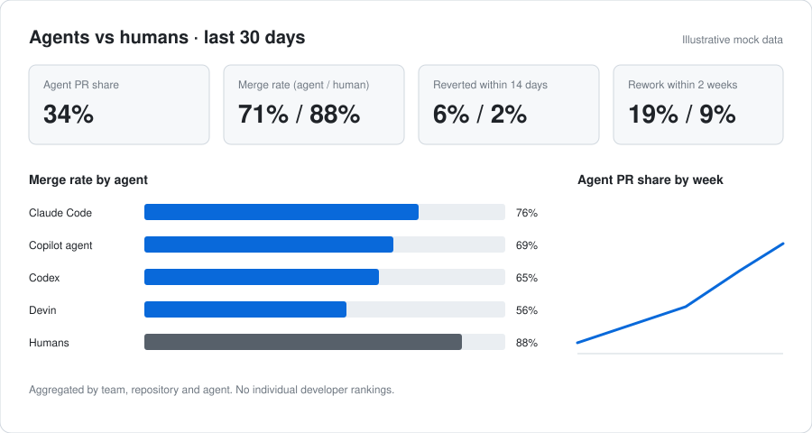

# Tandemetry

**See how humans and AI agents ship code together.**

Open-source, self-hosted analytics for AI coding agents: compare agent vs human work in your
repositories — merge rate, reverts, rework, CI failures, review load and cost per PR.

> Status: early development (v0.1 in progress). Not ready for production use.

## Why

AI agents now open a large share of pull requests, but teams can't tell whether that code is
merged, reverted or rewritten — or which agent works best in their codebase. Tandemetry answers
that from your own Git data, without sending code anywhere and without LLM calls.

## What you will see



Every number is traceable: each PR is labelled `agent`, `human` or `mixed` by a transparent rule
(bot author, commit trailer, PR description, branch name), and the matched rule is stored with the
label. See [agent attribution](docs/attribution.md) and the
[signatures research](docs/research/signatures.md).

## How it works

GitHub webhooks and a history backfill feed Kafka. The attribution engine labels each event,
ClickHouse computes the metrics, and Grafana and a metrics API read them. PostgreSQL holds the
configuration. Details: [architecture](docs/architecture.md).

## Principles

- **Self-hosted.** Your code and data stay in your infrastructure.
- **Agent-agnostic.** Claude Code, Codex, Copilot coding agent, Devin, Cursor and more.
- **Outcomes, not activity.** Reverts and rework, not just PR counts.
- **No individual rankings.** Teams, repositories and agents only.
- **Deterministic.** Transparent attribution rules, no LLM in the core.

## Docs

- [Product](docs/product.md)
- [Architecture](docs/architecture.md)
- [Agent attribution](docs/attribution.md)
- [Roadmap](docs/roadmap.md)
- [Releasing](docs/releasing.md)
- [Architecture decisions](docs/adr/)

## License

[Apache-2.0](LICENSE). Copyright 2026 Yevhenii Korniev.

## Author

Created and maintained by [Yevhenii Korniev](https://github.com/Korniev).

## Development

Requires [uv](https://docs.astral.sh/uv/).

```bash
uv sync
uv run pre-commit install
uv run pytest
uv run ruff check . && uv run ruff format --check .
uv run mypy
uv run tandemetry --version
```

Local service stack (Kafka, ClickHouse, PostgreSQL):

```bash
cp deploy/.env.example deploy/.env
docker compose -f deploy/docker-compose.yml --env-file deploy/.env up -d --wait
```

See [deploy/README.md](deploy/README.md) for verification and troubleshooting.
