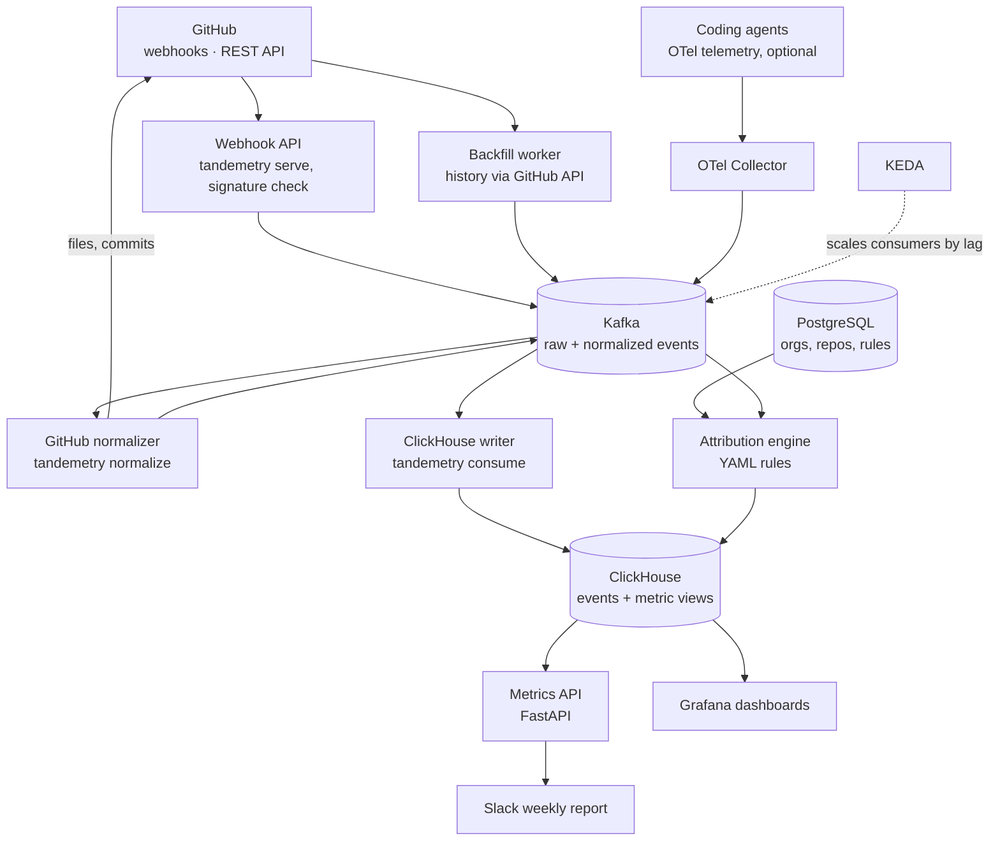

# Architecture (v0.1)

Every event flows through Kafka; the attribution engine decides agent vs human; ClickHouse
computes cohort metrics; Grafana and the API read from ClickHouse.

Implemented so far: GitHub ingestion (webhook → `raw.github` → normalizer with the GitHub API →
`events.normalized`), the unified event model and the ClickHouse writer (`events.normalized` →
`events`). The rest of the diagram is the v0.1 target; progress is
tracked in the [roadmap](roadmap.md).



## Components

| Component | Responsibility |
| --- | --- |
| Webhook API | `tandemetry serve`: verifies the HMAC signature, publishes supported deliveries unchanged to `raw.github` |
| GitHub normalizer | `tandemetry normalize`: `raw.github` → events, fetching files and commits from the GitHub API → `events.normalized` |
| Backfill worker | Pulls history (PRs, commits, reviews, check runs) respecting rate limits; resumable |
| Kafka | Topics `raw.github`, `events.normalized`, `events.attributed`; replay for re-attribution |
| Attribution engine | Applies rules (`docs/attribution.md`) to normalized events, emits attributed events |
| ClickHouse writer | `tandemetry consume`: `events.normalized` → `events`, commit after insert |
| ClickHouse | `events` table (deduplicated by `event_id`) + materialized views for metrics |
| PostgreSQL | Installations, repositories, attribution rules, settings |
| Metrics API | Cohort metrics endpoints; feeds Slack report |
| Observability | OTel traces across Kafka, Prometheus metrics (consumer lag, errors), Grafana |

## Unified event model

All platforms map into one domain model (future GitLab/Azure DevOps adapters produce the same),
defined in `src/tandemetry/events/` (the source of truth). An `Event` envelope carries `event_id`,
`source` (platform, e.g. `github`, the same for webhooks and backfill), `repo_id` (the platform's
numeric repository id), `repo` (`owner/name`), `occurred_at` and a `payload` discriminated by
`type`:

| `type` | Fields | Natural key |
| --- | --- | --- |
| `pull_request` | number, action (opened/edited/closed/reopened), author, body, head branch, labels | number + action |
| `commit` | sha, pull request, author login and email, message (for trailers) | sha + pull request |
| `review` | review id, pull request, reviewer | review id |
| `check_run` | check run id, name, head sha, conclusion | check run id |
| `merge` | pull request, merge commit sha, changed files (path, additions, deletions) | pull request |
| `revert` | revert commit sha, reverted shas and/or reverted pull request | sha |

Events are immutable and reject unknown fields. The wire format is the envelope as JSON.

**`event_id`** = `uuid5(namespace, "source|repo_id|type|natural_key|occurred_at_utc_iso")`, where the
namespace is `uuid5(NAMESPACE_URL, "https://github.com/tandemetry/tandemetry/events/v1")`. The same
fact always gets the same id, so consumers deduplicate Kafka redeliveries, replays and
webhook/backfill overlaps by `event_id`. Deserialization rejects an id that does not match the
fact, so changing the recipe means bumping the namespace version and re-deriving stored events.

**Stream.** A message on `events.normalized` has the `repo_id` as its key (decimal UTF-8
string), so a repository's events share a partition and keep their order (ADR-001), and the
`Event` JSON as its value; consumers validate it, which rejects an `event_id` that does not match
the fact. Producers use `acks=all` with the idempotent producer, which removes duplicates from
retries within one producer session only. Delivery is at-least-once: restarts, replays and
webhook/backfill overlap produce duplicates, and sinks remove them by `event_id`.

**Storage.** `tandemetry migrate` applies `src/tandemetry/storage/clickhouse_migrations/` (one
idempotent DDL statement per file, in name order; see [ADR-004](adr/004-clickhouse-schema-migrations.md)). The `events` table is a `ReplacingMergeTree`
ordered by `(repo_id, type, occurred_at, event_id)`; since `event_id` is derived from those fields,
a redelivered event has the same sorting key and collapses into one row. Collapsing happens on
background merges, so exact reads use `FINAL` (or `argMax`), and materialized views, which fire
on every insert, must aggregate in a duplicate-safe way (e.g. `uniqExact(event_id)`, or a
`ReplacingMergeTree` target) rather than plain `count()`/`sum()`.

**Consumer.** `tandemetry consume` reads `events.normalized` in the consumer group
`tandemetry-clickhouse` (`auto_offset_reset=earliest` for a new group), writes each batch to
`events` in one insert and commits offsets only after the insert succeeds. A message that is not a
valid `Event` is logged (topic, partition, offset; never the payload), skipped and committed with
its batch. A failed insert or commit stops the process without committing, so the batch is
delivered again and deduplicated as described above. A batch the sink always rejects therefore
stops the consumer until the cause is fixed; a dead-letter topic is future work.

**`occurred_at`** is the platform's timestamp of the fact (PR `created_at`/`closed_at`, git
committer date, review `submitted_at`, check `completed_at`, PR `merged_at`), never the time Tandemetry received it. Every mapper
must pick the same timestamp for the same fact, or ids diverge.
`edited` and `reopened` have no dedicated timestamp: they use the webhook's `updated_at` and come
from webhooks only; backfill emits `opened` and `closed`.

**`repo_id`**, not the name, is part of the identity: renaming or transferring a repository keeps
its id, so facts stay deduplicated across renames and name case does not matter. `repo` is a label
holding the `full_name` at the time of the event.

Check runs link to pull requests through `head_sha` → `commit.sha` → `commit.pull_request`.

## GitHub ingestion

```
GitHub ─POST /webhooks/github─► serve ─► raw.github ─► normalize ─► events.normalized
         401 bad signature       202 after Kafka ack      │ GitHub REST API (read-only)
         204 unsupported event   key: repository id       │ files on merge, commits on push
         400 malformed body                               ▼
```

**Receiver** (`tandemetry serve`, `POST /webhooks/github`, `GET /healthz`). It checks
`X-Hub-Signature-256` (HMAC-SHA256 of the raw body, constant-time compare) before parsing
anything. Events other than `pull_request`, `pull_request_review` and `check_run` (e.g. `ping`)
get 204. A supported delivery is published to `raw.github` as `RawWebhook` (delivery id, event
name, repository id, body unchanged), keyed by repository id; every action is kept, so the raw
topic can be re-normalized after a mapper change. GitHub gets 202 only after Kafka acknowledged
the message (`acks=all`), so an accepted delivery is never lost; a Kafka failure returns 503 and
GitHub shows the delivery as failed, ready to redeliver. The receiver makes no GitHub API calls,
so it answers well within GitHub's 10 s delivery timeout, and nothing logs bodies or headers.
Bodies over `TANDEMETRY_API__MAX_BODY_BYTES` (25 MiB, GitHub's delivery cap) get 413 before they
are read in full. Kafka's default message limit is 1 MB, so producers allow
`TANDEMETRY_KAFKA__MAX_MESSAGE_BYTES` (32 MiB, room for the JSON-escaped body) and the
`raw.github` topic is created with the same `max.message.bytes`.

**Normalizer** (`tandemetry normalize`, consumer group `tandemetry-normalizer`) turns each raw
delivery into events and publishes them to `events.normalized`, committing offsets after the
whole batch is published:

| Delivery | Events | GitHub API |
| --- | --- | --- |
| `pull_request` `opened` | `pull_request` + one `commit` per PR commit | `GET /repos/{repo}/pulls/{n}/commits` |
| `pull_request` `synchronize` | one `commit` per PR commit | same |
| `pull_request` `edited` / `reopened` / `closed` | `pull_request` | — |
| `pull_request` `closed`, merged | `pull_request` + `merge` with changed files | `GET /repos/{repo}/pulls/{n}/files` |
| `pull_request_review` `submitted` | `review` | — |
| `check_run` `completed` | `check_run` | — |

On every push all PR commits are fetched again; known commits get the same `event_id` and
collapse downstream, so no state is needed. A deleted (ghost) author or reviewer produces no
`pull_request`/`review` event; a merge is still recorded. File `patch` text is never read.
The PR endpoints return at most 250 commits and 3000 files; larger PRs are incomplete until
backfill covers them.

Failures: a rate limit is waited out until the reset time (capped by
`TANDEMETRY_GITHUB__RATE_LIMIT_MAX_WAIT_S`), a server error or timeout is retried with exponential
backoff (`RETRY_INITIAL_S` doubling up to `RETRY_MAX_S`), and a delivery that is malformed or
whose repository/PR is gone (404/410) is logged (delivery id and position, never the body) and
skipped. Any other API error (e.g. 401 for a wrong App key) stops the worker without committing,
like the ClickHouse writer, so nothing is lost while the cause is fixed. Waits within one batch
are bounded by `TANDEMETRY_GITHUB__BATCH_DEADLINE_S` (100 minutes): a batch that would wait longer
stops the worker without committing, and a restart (by the orchestrator) retries it, which is
harmless because ids are stable. The deadline stays below the consumer's `max.poll.interval.ms`
(2 hours, `TANDEMETRY_KAFKA__NORMALIZER_MAX_POLL_INTERVAL_MS`), so the group never evicts a
waiting worker; a single rate-limit wait (at most an hour) always fits. Normalizers scale out up to the partition
count of `raw.github`; each repository stays on one partition and keeps its order.

**GitHub API client.** The App signs a JWT (RS256, `iss` = Client ID, valid 9 minutes, backdated
60 s against clock skew) with its private key, exchanges it for an installation access token
(`POST /app/installations/{id}/access_tokens`, about 1 h; this only mints a token and writes
nothing to repositories) and caches the token per installation until 5 minutes before expiry.
Requests send `X-GitHub-Api-Version: 2022-11-28`, page with `per_page=100` and follow the `Link`
header. The only outbound host is `TANDEMETRY_GITHUB__API_URL` (default `https://api.github.com`;
GitHub Enterprise Server uses `https://<host>/api/v3`). Each page fetches the cached token, so a
long listing survives a token refresh. For the backfill the client reads only `GET` endpoints:
`/repos/{repo}`, `/pulls?state=all&sort=updated&direction=desc` (paging stops at the first PR
updated before `--since`), `/pulls/{n}/reviews`, `/pulls/{n}/commits`, `/pulls/{n}/files` and
`/commits/{sha}/check-runs?filter=all` (every run, not only the latest per name).

## Deployment

- Local / trial: `docker compose up` (single node). Today `deploy/docker-compose.yml` runs the
  infrastructure (Kafka, ClickHouse, PostgreSQL, see [deploy/README.md](../deploy/README.md));
  application services join it as compose profile `app` (next roadmap item).
- Production: Helm chart; consumers scaled by KEDA on Kafka consumer lag.

## Security

GitHub App with read-only permissions (`deploy/github-app/manifest.json`, setup in
[github-app.md](github-app.md)); webhook secret and App private key via env/K8s secrets; no data
leaves the customer's infrastructure.
