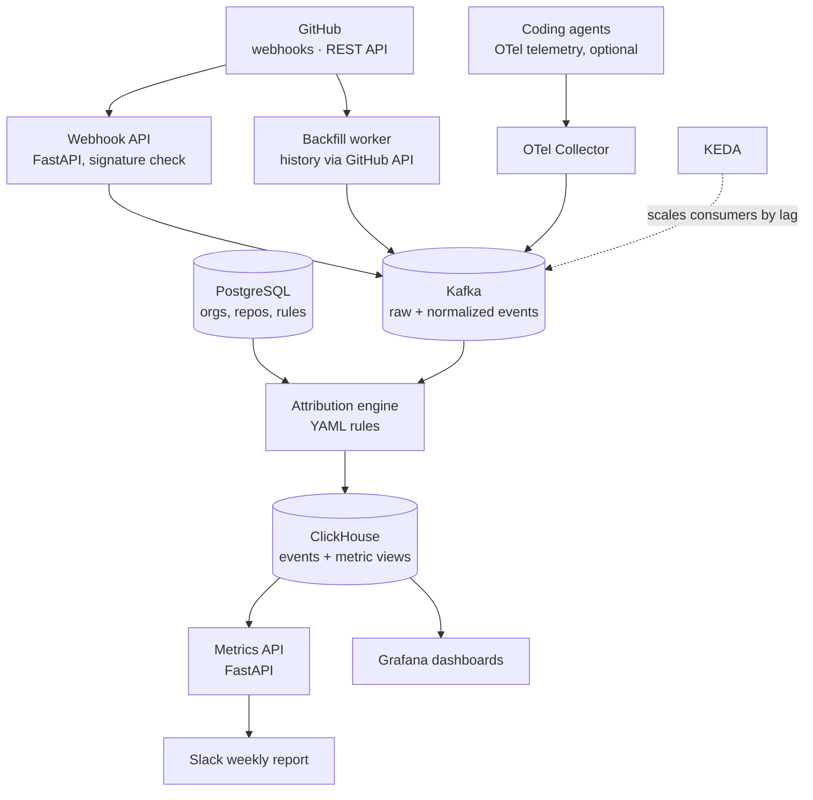

# Architecture (v0.1)

Every event flows through Kafka; the attribution engine decides agent vs human; ClickHouse
computes cohort metrics; Grafana and the API read from ClickHouse.

## Components

| Component | Responsibility |
| --- | --- |
| Webhook API | Receives GitHub webhooks, verifies HMAC signature, publishes raw events |
| Backfill worker | Pulls history (PRs, commits, reviews, check runs) respecting rate limits; resumable |
| Kafka | Topics `raw.github`, `events.normalized`, `events.attributed`; replay for re-attribution |
| Attribution engine | Normalizes events, applies rules (`docs/attribution.md`), emits attributed events |
| ClickHouse | Append-only event tables + materialized views for metrics |
| PostgreSQL | Installations, repositories, attribution rules, settings |
| Metrics API | Cohort metrics endpoints; feeds Slack report |
| Observability | OTel traces across Kafka, Prometheus metrics (consumer lag, errors), Grafana |

## Unified event model

All platforms map into one domain model (future GitLab/Azure DevOps adapters produce the same),
defined in `src/tandemetry/events/` (the source of truth). An `Event` envelope carries `event_id`,
`source` (platform, e.g. `github`, the same for webhooks and backfill), `repo_id` (the platform's
numeric repository id), `repo` (`owner/name`), `occurred_at` and a `payload` discriminated by
`type`:

| `type` | Fields | Natural key |
| --- | --- | --- |
| `pull_request` | number, action (opened/edited/closed/reopened), author, body, head branch, labels | number + action |
| `commit` | sha, pull request, author login and email, message (for trailers) | sha + pull request |
| `review` | review id, pull request, reviewer | review id |
| `check_run` | check run id, name, head sha, conclusion | check run id |
| `merge` | pull request, merge commit sha, changed files (path, additions, deletions) | pull request |
| `revert` | revert commit sha, reverted shas and/or reverted pull request | sha |

Events are immutable and reject unknown fields. The wire format is the envelope as JSON.

**`event_id`** = `uuid5(namespace, "source|repo_id|type|natural_key|occurred_at_utc_iso")`, where the
namespace is `uuid5(NAMESPACE_URL, "https://github.com/tandemetry/tandemetry/events/v1")`. The same
fact always gets the same id, so consumers deduplicate Kafka redeliveries, replays and
webhook/backfill overlaps by `event_id`. Deserialization rejects an id that does not match the
fact, so changing the recipe means bumping the namespace version and re-deriving stored events.

**`occurred_at`** is the platform's timestamp of the fact (PR created/closed, committer date,
review submitted, check completed, merged), never the time Tandemetry received it. Every mapper
must pick the same timestamp for the same fact, or ids diverge.
`edited` and `reopened` have no dedicated timestamp: they use the webhook's `updated_at` and come
from webhooks only; backfill emits `opened` and `closed`.

**`repo_id`**, not the name, is part of the identity: renaming or transferring a repository keeps
its id, so facts stay deduplicated across renames and name case does not matter. `repo` is a label
holding the `full_name` at the time of the event.

Check runs link to pull requests through `head_sha` → `commit.sha` → `commit.pull_request`.

## Deployment

- Local / trial: `docker compose up` (single node). Today `deploy/docker-compose.yml` runs the
  infrastructure (Kafka, ClickHouse, PostgreSQL, see [deploy/README.md](../deploy/README.md));
  application services join it with the first runnable service.
- Production: Helm chart; consumers scaled by KEDA on Kafka consumer lag.

## Security

GitHub App with read-only permissions; secrets via env/K8s secrets; no data leaves the
customer's infrastructure.
