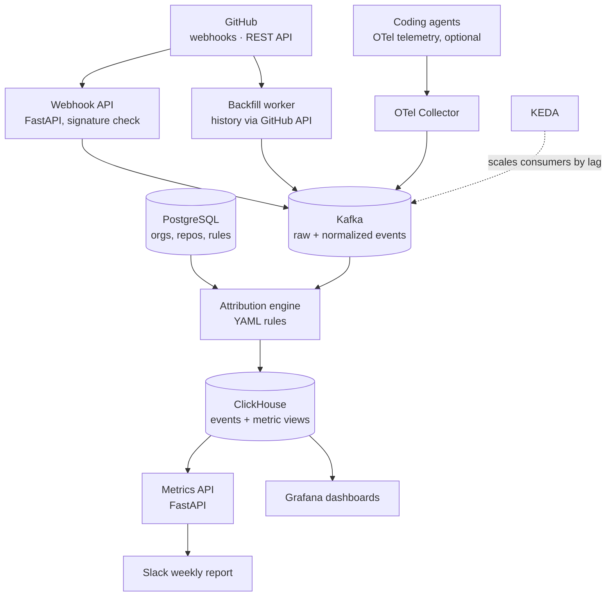

# Architecture (v0.1)

Every event flows through Kafka; the attribution engine decides agent vs human; ClickHouse
computes cohort metrics; Grafana and the API read from ClickHouse.

## Components

| Component | Responsibility |
| --- | --- |
| Webhook API | Receives GitHub webhooks, verifies HMAC signature, publishes raw events |
| Backfill worker | Pulls history (PRs, commits, reviews, check runs) respecting rate limits; resumable |
| Kafka | Topics `raw.github`, `events.normalized`, `events.attributed`; replay for re-attribution |
| Attribution engine | Normalizes events, applies rules (`docs/attribution.md`), emits attributed events |
| ClickHouse | Append-only event tables + materialized views for metrics |
| PostgreSQL | Installations, repositories, attribution rules, settings |
| Metrics API | Cohort metrics endpoints; feeds Slack report |
| Observability | OTel traces across Kafka, Prometheus metrics (consumer lag, errors), Grafana |

## Unified event model

All platforms map into one domain model (future GitLab/Azure DevOps adapters produce the same):
`PullRequest`, `Commit`, `Review`, `CheckRun`, `Merge`, `Revert`. Each event has a stable
`event_id` (idempotency), `source`, `repo`, `occurred_at`, payload.

## Deployment

- Local / trial: `docker compose up` (all components, single node).
- Production: Helm chart; consumers scaled by KEDA on Kafka consumer lag.

## Security

GitHub App with read-only permissions; secrets via env/K8s secrets; no data leaves the
customer's infrastructure.
