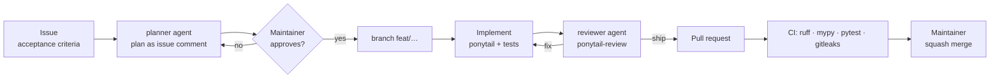

# Development process (AI-assisted SDLC)

Tandemetry is built by one maintainer working with AI coding agents (Claude Code).
The process keeps the human accountable for every decision and every merged line,
and keeps agent work visible and reviewable.

## Principles

1. **Docs are the source of truth.** `CLAUDE.md`, `docs/` and ADRs are read by humans and
   agents alike. If it is not written down, the agent does not know it.
2. **Plan before code.** Non-trivial work starts with a written plan the maintainer approves.
3. **Smallest complete change.** One issue → one small PR (ponytail).
4. **Independent review.** The reviewer did not write the code.
5. **The human merges.** Agents never merge, force-push or touch `main` directly.
6. **No merge without understanding.** The maintainer must be able to explain every line.
7. **Agent work is attributed.** Agent-assisted commits keep the `Co-Authored-By` trailer —
   which is also the data Tandemetry itself analyses (we dogfood on our own repo).

## Workflow

| Step | Who | How |
| --- | --- | --- |
| 1. Issue | maintainer | GitHub issue with acceptance criteria, in a milestone |
| 2. Plan | `planner` agent | `Use the planner agent to plan issue #N` → paste plan as issue comment |
| 3. Approve | maintainer | edit/approve the plan; do the listed maintainer actions |
| 4. Branch | maintainer | `git switch -c feat/<short-name>` |
| 5. Implement | maintainer + agent | ponytail mode; tests with every non-trivial change |
| 6. Review | `reviewer` agent | `Use the reviewer agent on this branch` → fix Must/Should findings |
| 7. PR | maintainer | `gh pr create`; template checklist; `Closes #N` |
| 8. CI | GitHub Actions | ruff, mypy, pytest, gitleaks must pass (required checks) |
| 9. Merge | maintainer | squash merge; branch auto-deleted |

## Explain mode

Agents write the code. Part of the goal of this project is hands-on experience with Kafka,
ClickHouse, Kubernetes, KEDA and OpenTelemetry, so whenever a change touches one of them the
agent adds an **Explain** section:

- **What** was configured and **why** (link to the ADR if relevant)
- **How it works** in plain words (e.g. partitions, consumer groups, materialized views)
- **How to verify** locally — exact commands and expected output
- **Pitfalls** worth knowing

And a **Maintainer actions** list for anything the agent cannot or must not do itself
(GitHub UI settings, accounts and tokens, installing local tools).

## Quality gates

| Gate | When |
| --- | --- |
| Plan approved | before code |
| `reviewer` verdict "Ship" | before PR |
| CI green (required status checks) | before merge |
| `ponytail-audit` report in `docs/audits/` | end of each milestone |
| New ADR (`/new-adr`) | when an architectural decision changes |

## Conventions

- Branches: `feat/`, `fix/`, `docs/`, `chore/`, `refactor/`, `test/`.
- Commits and PR titles: Conventional Commits (`feat: …`, `fix: …`).
- Releases: tags `vX.Y.Z` on `main` (trunk-based, no long-lived branches).
- Agent permissions: `.claude/settings.json` (shared), `.claude/settings.local.json` (personal).
